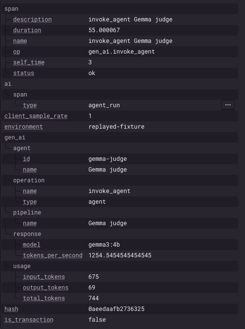

# Exorcist

**A CLI that scans your installed npm dependencies for malicious packages.** Four
deterministic rules pick the suspects. A Gemma 3 4B model running locally on your own
machine reads each one and decides what it is actually doing. Nothing leaves the laptop.

[](https://github.com/Ackberry/exorcist/actions/workflows/ci.yml)
[](https://github.com/Ackberry/exorcist/actions/workflows/codeql.yml)
[](LICENSE)


<details>
<summary>The same scan as text</summary>

```text
$ exorcist demo/victim --no-oracle

packages  5 installed · 3 haunted · 2 quiet

soul-snatcher@1.0.0
  █████████░   93/100  remove  direct
  critical    runs a postinstall script
  medium      reads process.env
  medium      contains a base64 payload
  medium      installed but never imported
  exorcism  remove — Haunting score 93/100 is at least 75.

lodasg@1.0.0
  ███░░░░░░░   28/100  swap  direct
  high        name imitates lodash
  exorcism  swap — Swap lodasg for lodash.

quiet
  lucky-charm@1.0.0
  preact@1.0.0
```

</details>

## What it looks for

| Ghost | What it catches | Severity |
| --- | --- | --- |
| **Poltergeist** | Install hooks, and risky APIs anywhere in the package: `child_process`, network modules, `process.env`, SSH paths, `.npmrc`, `eval` / `Function`, base64 blobs, and names hidden behind `\xNN` escapes | up to critical |
| **Doppelganger** | Typosquats and impersonation — `lodasg` pretending to be `lodash` | high |
| **Phantom** | A direct dependency nothing imports, requires, or names in a root script. Its install hooks still run | medium |
| **Revenant** | A release after 365+ days of silence, or under a maintainer the previous release did not have | medium |

Rules are the cheap filter: regexes and lockfile arithmetic, run against files on disk.
Only packages a rule flags are sent to the model, and quiet packages are never sent at
all. The rule total is a **floor** — Gemma can raise a package's score and can never
lower one.

Each package comes back with a score out of 100 and one fix: `pin`, `swap`, or `remove`.

## Is it any good?

Honest answer: it is noisy, and the repo says so rather than hiding it. Scanning this
project's own 346 dependencies, rules-only, flags 100 of them — mostly revenant findings
at `pin`, which means "shipped again after a long quiet", which is suspicious and also
completely normal. One is a genuine false positive: `trough` read as a typosquat of
`through`. Treat the score as a starting point for a person, not a gate to automate on.

Every claim this README and the write-up make about `gemma3:4b` has a real recorded
response checked into [`test/fixtures/`](test/fixtures/) — the tools refusal, a rejected
schema and the retry that recovers it, the judgment path, the lookalike path, and two
answers the parser rejects. The test suite replays them and never contacts Ollama.

## What a scan costs

Tracing is opt-in behind `SENTRY_DSN` and off otherwise. With it on, one scan is a single
`invoke_workflow haunt` transaction: five `workflow.step` spans, plus a
`gen_ai.invoke_agent` span and a `chat gemma3:4b` child for every package the rules
flagged.



`resolve`, `rules` and `score` together come to about eleven milliseconds for five
packages. Everything else is the model. That is the whole case for rules-as-a-filter:
the deterministic pass is effectively free, so the expensive part only runs on packages
something already flagged, and quiet packages are never sent at all.

The `environment` tag on that span reads `replayed-fixture` because the model host was
unreachable when it was captured, so the answers came from `test/fixtures/`. The token
counts are the real ones from those recorded responses. The durations are not — ignore
`tokens_per_second` there; real `gemma3:4b` on that machine runs at about 13 tokens per
second.

## Safety

The code it reads may be private. The model runs on your machine, the scan works with the
network unplugged, and nothing here calls a cloud LLM API. Revenant asks the public npm
registry for publish dates; with no network it finds nothing and the scan carries on.
**Exorcist reads package source. It never executes it.**

A scan does not follow a symlink out of a package, a lockfile path into a credential
directory, or a redirect from Ollama. A `file:` dependency is read only when its real path
stays inside the git repository that contains the project. If the project is not in a git
checkout, that path has to stay inside the parent of the scanned directory, and that
parent is never your home directory. `--endpoint` is the Ollama origin. A username, a
password, or a redirect is refused.

Built for the DEV Hacktoberfest Open-Source AI Challenge, Week 4: "Ghost in the Machine".

## Quickstart

Node.js 22.13 or newer.

```bash
npm install
npm run build
npm install --prefix demo/victim
npx tsx src/cli.ts demo/victim
```

`npm install` inside `demo/victim` only links the local fixtures under `demo/packages/`. It does not download them from the registry. `soul-snatcher` has a postinstall script. The script prints one line and does not open a socket, write a file, or print a token. That line during install is expected.

You do not need Ollama for the command above. If it is not running, Exorcist says so and writes the report from the rules alone.

To let Gemma judge the flagged snippets:

```bash
# https://ollama.com
ollama pull gemma3:4b
npx tsx src/cli.ts demo/victim
```

A smaller model works too:

```bash
ollama pull gemma3:1b
npx tsx src/cli.ts demo/victim --model gemma3:1b
```

After `npm run build`, the same scan is `node dist/cli.js demo/victim`.

What you should see on `demo/victim`:

| Package         | Why it shows up                                                    | Exorcism without Gemma |
| --------------- | ------------------------------------------------------------------ | ---------------------- |
| `soul-snatcher` | `postinstall`, `process.env`, a base64 encode, and never imported | remove (score 93)      |
| `hexed-helper`  | `eval` of a base64 blob, a long base64 literal, and never imported | remove (score 60)      |
| `lodasg`        | name is one character from `lodash`, and the text imitates lodash | swap (score 28)        |
| `preact`        | imported, and the exact popular name is not a typosquat of `react` | quiet (score 0)       |
| `lucky-charm`   | imported by `src/app.js`, and no risky API                         | quiet (score 0)        |

Those scores are the rule floors. When Gemma is running it can raise a score. It cannot lower one. `--no-oracle` prints the floors. On a lookalike, the report's oracle line is whether the package is an impostor of the real name, not only whether the code is harmful. `lodasg` stays `swap` at its rule score when the only finding is the typosquat, even if Gemma calls the impostor malicious. A harmful rule on that same package can still remove it. `soul-snatcher` and `hexed-helper` stay `remove` because they are unused.

Rules only, without Gemma:

```bash
npx tsx src/cli.ts demo/victim --no-oracle
```

The command writes `haunting-report.md` in the current directory (gitignored) and prints the same findings in the terminal.

## Usage

```text
exorcist [path] [options]
```

`path` defaults to the current directory. Exorcist reads `package-lock.json` there (lockfileVersion 2 or 3). It does not execute dependency code. It does not read `pnpm-lock.yaml` or `yarn.lock`.

| Flag               | Meaning                                                                       |
| ------------------ | ----------------------------------------------------------------------------- |
| `--model <name>`   | Ollama model. Default `gemma3:4b`.                                            |
| `--endpoint <url>` | Ollama API. Default `http://localhost:11434`. A bare `host:port` is accepted. |
| `--no-oracle`      | Do not call Gemma. Rules still run.                                           |
| `--report <file>`  | Markdown report. Default `./haunting-report.md`.                              |
| `--json`           | Print the report as JSON on stdout. The Markdown file is still written.       |
| `--fail-on <score>` | Exit 2 when a package scores at least `<score>`. Without it a finished scan always exits 0. |

### Failing a build on a score

`--fail-on <score>` is the only way Exorcist returns a non-zero code for what it found.
Exit codes are:

| Code | Meaning |
| --- | --- |
| 0 | the scan finished |
| 1 | the scan could not run |
| 2 | the scan finished and `--fail-on` was met |

Keeping 2 separate from 1 matters in CI: a tripped threshold is a result, a 1 is a broken
step, and you want to tell them apart.

```bash
node dist/cli.js . --no-oracle --fail-on 75
```

The report is still written when the threshold trips, so a failing job leaves evidence.

As a GitHub Action. Rules-only is the default here on purpose — a runner has no Ollama
and no model pulled, and the scan is designed to be useful without one:

```yaml
- uses: actions/checkout@v5
- uses: actions/setup-node@v5
  with:
    node-version: "22.13"
- run: npm ci && npm run build
- name: Scan dependencies
  run: node dist/cli.js . --no-oracle --fail-on 75
- if: always()
  uses: actions/upload-artifact@v4
  with:
    name: haunting-report
    path: haunting-report.md
```

Pick the threshold from a real scan of your own tree rather than copying 75. Exorcist is
noisy; see the section above.

### JSON output

`--json` writes the same `HauntingReport` the Markdown file describes, as JSON on stdout:

```bash
npx tsx src/cli.ts demo/victim --no-oracle --json > report.json
npx tsx src/cli.ts demo/victim --no-oracle --json | jq '.hauntings[] | {name, hauntingScore, exorcism}'
```

stdout carries the document and nothing else, so it pipes cleanly. The terminal view is
skipped and the `wrote <file>` line goes to stderr. The Markdown report is still written,
and `--report` still names it.

Package names, evidence and model text are stripped of ANSI, C0 controls and bidi overrides,
the same way the terminal and Markdown reports strip them. Nothing is flattened or clipped:
evidence keeps its newlines, and long model text is not truncated.
| `-h`, `--help`     | Help.                                                                         |

Environment overrides, used when the matching flag is absent:

| Variable       | Meaning                                                                       |
| -------------- | ----------------------------------------------------------------------------- |
| `OLLAMA_MODEL` | Same as `--model`.                                                            |
| `OLLAMA_HOST`  | Same as `--endpoint`. Ollama's own variable. `127.0.0.1:11434` or a full URL. |
| `SENTRY_DSN`   | Opt-in Sentry agent trace for this scan. Unset means nothing is sent.        |
| `SENTRY_TRACE_CONTENT` | Set to `1` to include prompts and model text. Default is metadata only: step names, model, latency, tokens, and verdict. |
| `SENTRY_ENVIRONMENT` | Optional trace environment. Default `local`.                             |

Exit code `0` means the scan finished, even if packages are haunted. Exit code `1` means the scan could not run (bad arguments, missing directory, unreadable or unsupported lockfile). The process sets that code and waits until open handles finish closing.

Inside this repository, run `npx tsx src/cli.ts` or `node dist/cli.js`. `package.json` has a `bin` entry named `exorcist`, so `npx exorcist` works **after this package is installed** (`npm install -g .` from a clone, or as a dependency of another project). Running `npx exorcist` here, before that, asks the npm registry for a different package named `exorcist`.

Point `--endpoint` at a machine you trust. The default is your local Ollama. The flag is parsed as an origin, and Exorcist does not follow a redirect from that host. A remote endpoint would send flagged source there.

## Demo fixtures

Everything under `demo/packages/` is a private fixture. None of it phones home.

- `soul-snatcher` — postinstall reads `EXORCIST_DEMO_TOKEN` (or the literal `not-a-real-secret`), base64-encodes it, and logs the length.
- `lodasg` — typosquat of `lodash` (`h` changed to `g`). The description, README, and `get` / `chunk` helpers imitate lodash. `NOTICE` in that directory says it is a fixture; the scanner does not read `NOTICE`. The victim app imports it, so the exorcism is swap rather than phantom's remove.
- `preact` — one letter from `react`, and itself on the popular-name list, so doppelganger stays quiet.
- `hexed-helper` — `mutter()` would `eval` a base64 string that decodes to `console.log("boo")`. Nothing calls `mutter()`. A second literal is a long harmless base64 blob.
- `lucky-charm` — returns `"horseshoe"`. A quiet control.
- `demo/victim/src/app.js` — imports `lucky-charm`, `lodasg`, and `preact`. Phantom reads this file. `soul-snatcher` and `hexed-helper` are installed and never referenced, so each one is a phantom finding on top of whatever poltergeist already found.

If you skip `npm install` in `demo/victim`, the committed lockfile still points at the fixtures with `link: true`, and the resolver follows those paths. Install once if you want `node_modules` populated.

## How a scan runs

1. Read `package-lock.json` and list installed packages (name, version, path, `package.json`).
2. Run every rule. **Poltergeist** flags risky install scripts and APIs. **Doppelganger** flags a name that imitates a popular package. **Phantom** flags a direct dependency the project never imports or names in a script. **Revenant** flags a release that landed after a long silence, or under a maintainer the previous release did not have. Revenant is the one rule that reads the npm registry; every other rule works from the files on disk.
3. If Ollama is up and the model is pulled, the Mastra judge asks Gemma about each haunted package: the flagged code, and the stated purpose (name, description, and a README excerpt when a README is present). Package text is treated as data, not as instructions. The request is Ollama's JSON schema on `/api/chat`, not a tool call. A doppelganger hit uses a separate question: does this package claim the real package's identity under a different name? Gemma returns `impersonating` true or false. A harmless copy that says it is lodash is an impostor. The report shows that, for example `impostor of lodash (0.90)`, and the score still cannot fall below the rule total. A dropped connection or an HTTP 500 is retried once.
4. The reported score is Gemma's score, or the rule total when that total is higher. With `--no-oracle`, or when the call fails, the score is the rule total only. Pick an exorcism: `pin`, `remove`, or `swap`.
5. Print the terminal report and write `haunting-report.md`.

Quiet packages stay out of the oracle. Details, types, and the score formula are in [docs/ARCHITECTURE.md](docs/ARCHITECTURE.md). What is stubbed, and what to build next, is in [docs/STATUS.md](docs/STATUS.md).

## Scripts

| Script                       | What it does                                    |
| ---------------------------- | ----------------------------------------------- |
| `npm run build`              | Compile `src/` to `dist/` with `tsc`, then mark `dist/cli.js` executable. Works on Windows, where the `chmod` command is missing. |
| `npm test`                   | Unit tests (`vitest`). They do not need Ollama. |
| `npm run dev -- demo/victim` | Same as `tsx src/cli.ts demo/victim`.           |
| `npm run lint`               | Biome, then `tsc --noEmit`.                     |
| `npm run format`             | Biome format, write.                            |

## License

MIT.
